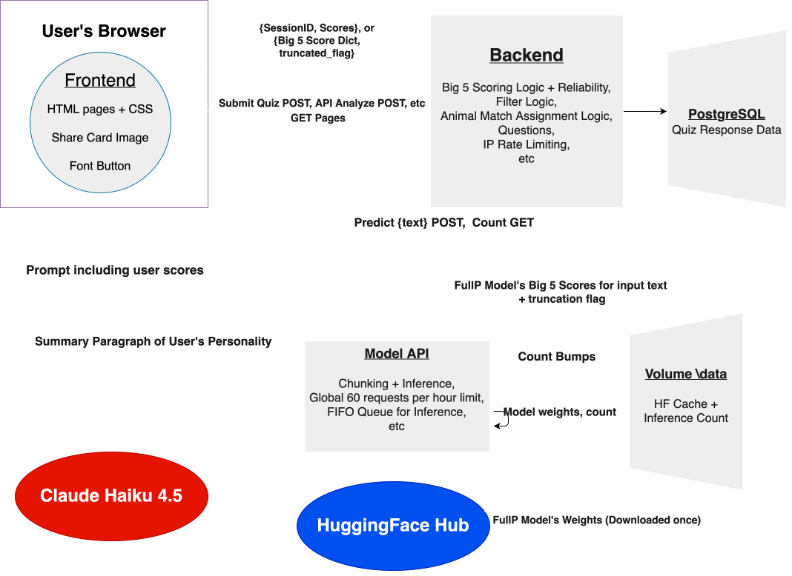

# Aleph Psychometrics

**Live site:** [alephpsychometrics.org](https://alephpsychometrics.org)

**Model:** [Ritsuk0/aleph-big5-fullp](https://huggingface.co/Ritsuk0/aleph-big5-fullp) on Hugging Face

**Model write-up:** [Aleph_Psychometrics_Model_Writeup.pdf](docs/Aleph_Psychometrics_Model_Writeup.pdf)

**Synthetic Data:** [Ritsuk0/aleph-big5-synthetic](https://huggingface.co/datasets/Ritsuk0/aleph-big5-synthetic) on Hugging Face

The overall aim of this project was to build an ML model capable of predicting a person's Big 5 personality trait scores from text that person wrote. The personality signal contained in written text has been studied before, but labeled Big 5 data is scarce, and as far as I know, recent encoder models had not really been applied to this problem. So we wanted to explore whether more data and more modern tools would lead to better results. At its core, this is what the project set out to find.

In simple terms, this meant we had to collect our own dataset, train our own model, evaluate it, and then serve it on the website so anyone could try it. 


## 1. Data collection: the quiz

To train and evaluate a model, we needed text written by people alongside scientifically validated Big 5 scores for those same people. No dataset like this existed for Reddit at the scale we wanted, so we built a website to collect one.

The quiz page shows users 65 questions in a randomized order, each answered on a 1–5 Likert scale (strongly disagree to strongly agree). The quiz is built around Big 5 items drawn from the IPIP-50 inventory, along with a few filter questions used to flag people who aren't taking it seriously (see below).

At the end, users can optionally provide their Reddit username. They're told their public posts will be used for research on whether Big 5 traits can be predicted from text alone, and that their data will be anonymized and never sold. We keep our promises in this regard.

### Scoring

Each Big 5 trait is the sum of its 6 items (reverse-keyed items are flipped with (6 - answer)), rescaled to 0–100:

```
score = (raw_sum - 6) / 24 * 100
```

so 6 (all lowest) maps to 0 and 30 (all highest) maps to 100. The formula above allows us to transform the Likert scale questions into a 0-100 scale. This lives in `app/services/scoring.py`.

### Reliability filter

The accuracy of the score-to-text pairing is essential for the model, and given how little data we expected to gather, even a few unserious responses could be harmful. So every submission gets a reliability flag based on three checks (`app/services/quality.py`):

1. Absurd items: Questions 64 and 65 are statements almost no reasonable person would agree with. Strongly agreeing with both flags you: `(q64² + q65²) / 50 ≥ 0.62`.
2. Inverse pairs: Some question pairs are inverses of each other (e.g. "I often insult or belittle others" and "I am never mean to others"). If you strongly agree with one, we'd expect you to strongly disagree with the other. Pairs (12, 66) and (17, 22) are checked: `((a1 - (6-a2))² + (b1 - (6-b2))²) / 32 ≥ 0.6` flags you.
3. Answer Frequency: If a single answer option makes up 95% or more of all responses (e.g. strongly agree to almost everything), the submission is flagged.

Failing any of the three marks the session as unreliable (`credibility_score = 0.0`). Separately, `validate_responses` rejects incomplete or malformed submissions before scoring.

### The hook

We quickly realized it's unrealistic to expect lots of people to spend 10+ minutes on a questionnaire when they stand to gain nothing, and more unrealistic still to expect them to share it out of charity. So we built a hook to make people excited to take and share the quiz:

- An animal match assigned deterministically from the scores (`pick_animal` in `app/services/summary.py`). We find the dominant "max trait" among openness, conscientiousness, agreeableness, low agreeableness, and low neuroticism, then use extraversion to choose between that max trait's animals:

  | Max trait | Animals (by extraversion) |
  |---|---|
  | Openness | macaw (≥65) / red fox / snow leopard (≤35) |
  | Conscientiousness | wolf (≥50) / beaver |
  | Agreeableness | quokka (≥65) / dolphin / stoat (≤35) |
  | Low agreeableness | lion (≥50) / crocodile |
  | Low neuroticism | capybara (≥50) / moose |

  Koala is the fallback, but it actually isn't even a possible option given that the algorithm above covers every possibility (sorry mate)
- A Personality Summary (Written by an LLM): the scores are sent to Claude Haiku 4.5, which writes a short paragraph about the user.
- A shareable image card with the scores, animal, summary, and site name (rendered client-side with html2canvas), so people would share it and make others curious enough to take the quiz.

This worked quite well: 682+ people took the quiz, and the whole thing cost less than $10 in inference (a win for my wallet).

---

## 2. The Reddit dataset

Out of the 682 quiz takers, 142 provided a valid Reddit username (which is a pretty surprising amount!). We used the Arctic Shift archive to retrieve each user's posts, and then packed each user's history into chunks:

- Whole items are packed into a chunk until the next one wouldn't fit, with a budget of about 4,080 ModernBERT tokens (just under the model's 4,096 limit, so nothing gets truncated in training).
- Each user gets at most 4 chunks, which matches the 4-chunk limit at inference time (see [the model API](#6-the-model-api)).
- Every chunk carries its user's Big 5 scores. All splitting and evaluation happens per user, never per chunk.

This gave 381 chunks spread across our 142 users. The dataset lives in a private Hugging Face repo which will not be made public, since it contains the posts of the nice users who decided to voluntarily provide their reddit handle (and I'm incredibly grateful for that). To be clear, their usernames and posts will not be made public or disclosed. 

Even though we ended up with a dataset of a decent size, we opted to use it primarily as a test set, given the fact that it's not large enough to make a significant difference to model performance, but it is high-quality enough to allow us to get some ballpark estimates of how well our models actually generalize to real people (who we have validated scores for!).

---

## 3. The model

We fine-tuned ModernBERT-large with a five-output regression head on several mixtures of Essays, PAN 2015 (tweets), PANDORA (Reddit), and a synthetic dataset of Reddit-style comments we generated with Claude, and we evaluated each model on the PAN 2015 test set and on our 142 Reddit users. Our best model, FullP (trained on all four sources), reaches a mean Pearson correlation of .398 on PAN 2015 and .141 on the Aleph Reddit test set (90% CI [.087, .194]).

The full methodology, per-trait results, and limitations are in the [model write-up](docs/Aleph_Psychometrics_Model_Writeup.pdf).

---

## 4. Architecture overview

The project runs as two separate services on Railway, inside the same project:



- The site serves every page, runs the quiz, stores responses, and acts as the only gateway to the model.
- The model API has no public domain. Only the site can reach it, over Railway's private network. This means the only way to run inference is through the site, and all of the site's per-IP protections apply.

The reason for splitting them is that they have very different needs. The site is light and runs fine with several workers, while the model takes ~2 GB of RAM and a lot of CPU per request, so it gets its own service where it can be configured, limited, and scaled as we see fit.

---

## 5. The site backend

Tech Stack: FastAPI, Jinja2 templates, SQLAlchemy on PostgreSQL, slowapi for rate limiting, served by gunicorn with 4 Uvicorn workers.

### Routes

| Route | What it does |
|---|---|
| `GET /` | Home page. Shows the quiz count (from the DB) and the texts-analyzed count (from the model API's `/count`, with a 1 s timeout; if the model API is asleep or down, that box is simply hidden). |
| `GET /quiz` | The quiz, with the questions shuffled. |
| `POST /submit` | Validates the responses, computes the scores and the reliability flag, gets the summary from Haiku, picks the animal, and stores everything. Limited to 3/minute per IP. |
| `GET /results/{session_id}` | The results page and share card. Session IDs are UUIDs, so results can't be guessed by incrementing a number. |
| `GET /analyze` | The text-analysis page. |
| `POST /api/analyze` | Forwards the user's text to the model API and returns the scores. Limited to 5/minute and 30/day per IP. |

### Database

Four tables (`app/models.py`):

- `quiz_sessions`: one row per attempt (timestamps, reliability, optional Reddit username, repeat-taker flag)
- `item_responses`: one row per answered question
- `big_five_scores`: the five trait scores
- `personality_summaries`: the Haiku summary and the animal

Tables are created on startup with `Base.metadata.create_all`. `scripts/export_csv.py` exports everything into one CSV for building the dataset (that CSV is gitignored btw dont worry hehe!)

### How `/api/analyze` works

The site validates the text itself first (200–100,000 characters) to avoid overencumbering the model with an entirely new category of bad requests. It then calls the model API with an `httpx.AsyncClient` and a 210 s timeout, which is slightly longer than the model API's own 200 s timeout, so the model API always gets to answer (or time out) first. Errors are translated into info that the user may find helpful:

| Situation | Status | Where it comes from |
|---|---|---|
| Text too short or too long | 422 | Site's own validation |
| Too many requests from this IP | 429 | Site's per-IP limit |
| Model API unreachable | 503 | Site (connection error) |
| Model API queue full | 503 | Passed through from the model API |
| Model API global limit hit | 429 | Passed through from the model API |
| Inference took too long | 504 | Passed through, or the site's own timeout |
| Anything else | 502 | Treated as our bug, not the user's |


---

## 6. The model API

Lives in `model-api/`. Two files:

### `model.py`: inference

The model and tokenizer are loaded once at import, from the public HF repo. `inference(text)`:

1. We run the tokenizer on the input text to get the text's corresponding token ids.
2. We split the tokens into windows of `4096 - 2 = 4094` tokens (saving room for `[CLS]` and `[SEP]`), keeping at most 4 chunks. Anything beyond that is dropped, and the response says so with `truncated: true`, so the user knows only part of their text was read.
3. We adds `[CLS]`/`[SEP]` to each chunk by hand and run each chunk through the model under `torch.inference_mode()`.
4. Each chunk gives us 5 raw outputs, one per trait, on the 0–1 scale the model was trained on. Since the regression head isn't bounded, an output can land slightly outside that range, so we cap each score at 1, and we make the floor 0. We then average each trait across the chunks, so every chunk counts equally, and multiply by 100 to get back to the 0–100 scale the quiz uses. Finally, we map the five scores to their trait names (using the model's id2label) and add the truncated flag and we return.

This mirrors how the training data was chunked, so a pasted text is seen the same way the training and test users were.

### `main.py`: the API

| Endpoint | What it does |
|---|---|
| `GET /health` | Returns `{"status": "ok"}`. |
| `GET /count` | How many texts have been analyzed. |
| `POST /predict` | Runs inference. Input 200–100,000 characters; output is the five scores (0–100) plus `truncated`. |

Inference is CPU-bound and can take close to a minute for long texts, so `/predict` has three layers of protection:

- A FIFO queue: A `ThreadPoolExecutor(max_workers=1)` means only one inference runs at a time and the rest wait their turn in order. Running several in parallel on a couple of vCPUs would just make all of them slow, so first come, first served is better for users.
- A cap on the line: At most 3 requests can be in line (including the one running). The 4th gets an immediate 503 instead of waiting indefinitely. The counter is protected by a `threading.Lock`, and a `done` callback decrements it when a job finishes.
- A timeout: If a request has waited 200 s, it gets a 504 and its job is cancelled if it hasn't started yet.

On top of that there's a global rate limit of 60/hour (slowapi with a key function that returns the same key for everyone). Since the site is the API's only client, a per-IP limit here would be meaningless. This is mainly a cost cap. The endpoint is written as a plain `def` instead of `async def`, to not block the main thread during inference (which is pretty time consuming).
### The counter

`/count` reads a number kept in memory and in a file (`COUNT_FILE`, on the Railway volume). After each successful inference, the count is incremented under a lock and written atomically: write to `count.txt.tmp`, `fsync`, then `os.replace` it over the real file, so a crash can never leave a half-written count. If the write fails, the user still gets their results.

---

## 7. Conclusion

Despite the simple concept, this project was quite time-consuming and spanned several months. It really forced me to think deeply across different dimensions. For example, it did not suffice to put out a website to collect data without also creating an incentive for people to voluntarily hand over this data. During the model development phase, I had to think critically about the results, and I had to interpret them in context. Even the best model seemingly did poorly on the Reddit test set that we created (r=0.141), its performance is competitive with the reportedly best NN-based model scores for the Pandora paper, but they evaluated their model on a different dataset, and their dataset is far less curated than our approach (that tests the user's Big 5 scores directly). To add to this, our model also does well on the Tweets test set (PAN15), meaning that its learned representations work across domains, which makes it more robust. Another thing I had to reflect deeply about was the limitations of the methodology. During the experimentation process, I did not put too much thought into mixture proportions for the dev set, and I simply made them proportional to the training set's ratios. Given that the Essays dataset is quite large compared to the others, it often dominated the dev set which means that our approach (saving the parameters with the best dev set performance) may have been picking a model better suited to text in the same domain as that of the Essays dataset, and less so the domains of our test sets. 

For the architecture building I had to balance a set of considerations, which meant that a lot of seemingly minor decisions required a lot more reflection. I had to make the website efficient, not too costly to run, keep things simple, and provide a good user experience. Things like deciding on a global inference limit per hour (60) and a per-IP inference limit per minute (5), or allowing our model API to sleep after it hasn't been used in a while were necessary cost-cutting measures. To make things efficient we created a question_ID indexed dictionary, that stored each QID's question information in order to avoid looping over every question just to find whether a particular QID is a filter question or not for example. To improve the user experience, I had to make sure that in case that the model api was busy analyzing text, a separate user would not have to spam the "analyze" button until the model finished to get their request submitted, so I created a FIFO queue that stored up to three analysis requests. I made the model API its own service to not have each gunicorn worker on the website api run around with their own 2GB+ copy of the model. The model weights are downloaded once and stored in the volume /data to avoid downloading them every single time the model API starts, speeding up the startup process. These are just some examples, but each of them required me to think about what sorts of things are priorities for my project, and they taught me how to reason about design tradeoffs. Now I have experience trying to maximize one thing while minimizing another, and more importantly, experience about how to react when I can't find a clear optimal solution that satisfies every goal.


---

## References

- Gjurković et al. (2021). PANDORA talks: Personality and demographics on Reddit.
- John, Naumann & Soto (2008). Paradigm shift to the integrative Big Five trait taxonomy.
- McCrae & Costa (1997). Personality trait structure as a human universal.
- Pennebaker & King (1999). Linguistic styles: Language use as an individual difference.
- Rangel Pardo et al. (2015). Overview of the 3rd author profiling task at PAN 2015.
